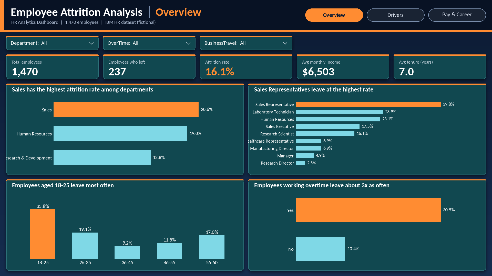
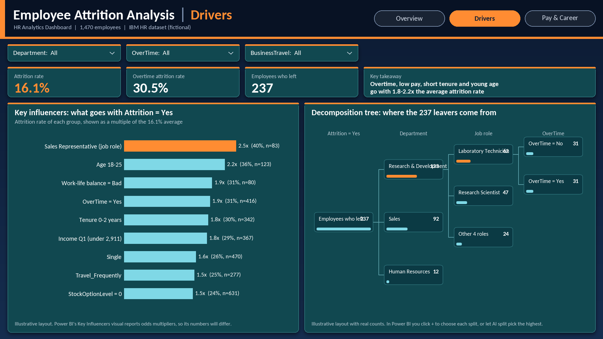
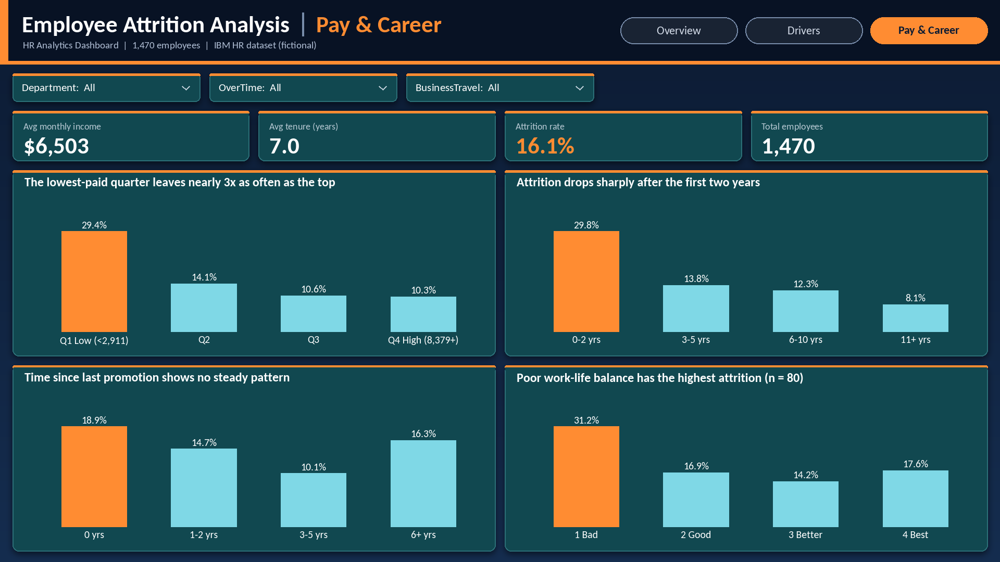
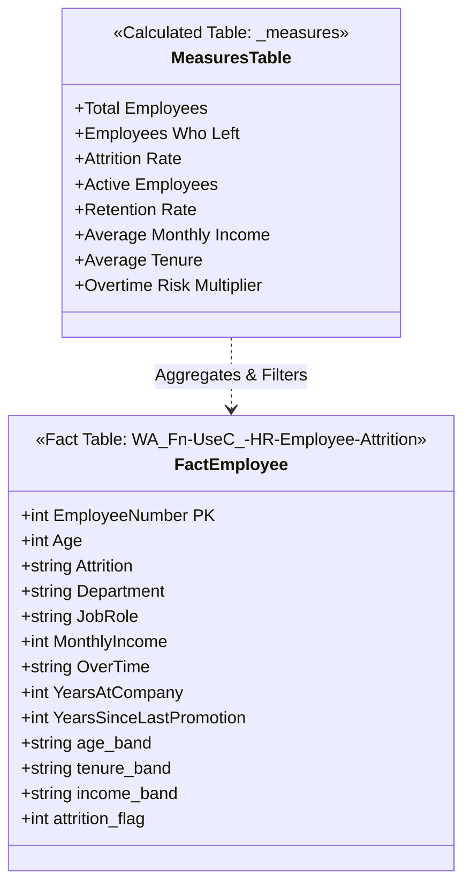

# HR Workforce Analytics & Attrition Intelligence (Power BI)

[](https://powerbi.microsoft.com/)
[](https://learn.microsoft.com/en-us/dax/)
[](https://learn.microsoft.com/en-us/powerquery-m/)
[](https://opensource.org/licenses/MIT)

An end-to-end People Analytics solution built in Power BI to quantify **$2.4M+ in turnover financial exposure**, diagnose root drivers of voluntary departures, and deliver an executive-level strategic retention roadmap.

---

## 📌 Executive Summary & Analytical Mandate

Unplanned employee turnover creates severe organizational drag through recruitment overhead, lost institutional knowledge, and diminished team velocity. This project moves People Operations from reactive exit reporting to **proactive flight-risk mitigation**.

```
========================================================================================
WORKFORCE HEALTH AT A GLANCE
========================================================================================
  Headcount        Departures       Attrition Rate    Avg Monthly Income    Avg Tenure
    1,470              237              16.12%              $6,503           7.0 Years
========================================================================================
```

### Key Business Insights
- **Overtime Flight Risk**: Employees working overtime depart at **30.5%** vs. **10.4%** for standard hours (**3.1× risk multiplier**).
- **Critical Tenure Cliff**: Attrition peaks sharply during **Years 0–2** before stabilizing significantly past Year 5.
- **Entry-Level Compensation Drag**: Staff earning **< $3,000/month** experience a **29.3%** departure rate.
- **Vulnerable Job Role**: **Sales Representatives** experience the highest segment attrition at **39.8%**, driven by quota pressure and entry-tier base pay.

---

## 📊 Dashboard Architecture & Live Previews

The dashboard is structured into three executive views designed for VP/C-suite decision making:

### 1. Executive Workforce Overview
> *High-level demographic health, departmental benchmarks, and overtime distribution.*



- **KPI Cards**: Headcount, Exits, Attrition %, Mean Salary, Mean Tenure.
- **Department Benchmarks**: Sales (20.6%), R&D (13.8%), HR (19.0%).
- **OverTime Impact**: Direct side-by-side volume and percentage departure comparison.
- **Age Distribution**: Stratified into 5 chronological cohorts (18–25, 26–35, 36–45, 46–55, 55+).

---

### 2. Attrition Drivers & AI Diagnostics
> *Root-cause diagnosis leveraging Microsoft AI Key Influencers and Decomposition Trees.*



- **AI Key Influencers Visual**: Automatically ranks statistical variance to detect top correlative features (e.g., OverTime, Single Marital Status, Low Job Level).
- **AI Decomposition Tree**: Interactive root-cause breakdown allowing executives to drill from Global Workforce → Department → OverTime → Job Role → Risk Probability.

---

### 3. Compensation, Tenure & Career Progression
> *Survival curve analysis, salary banding equity, and promotion velocity.*



- **Income Tiers**: Stratified brackets (`< $3k`, `$3k-$5k`, `$5k-$10k`, `$10k-$15k`, `$15k+`).
- **Tenure Survival Curve**: Quantifies the early-career cliff (`0–2 Years` vs `3–5 Years`).
- **Promotion Lag**: Evaluates departures against years elapsed since last promotion.
- **Work-Life Balance Impact**: Correlating subjective sentiment scores against actual retention.

---

## 🧩 Data Architecture & Data Model

The analytical model follows star schema modeling principles with a dedicated calculated measures table to maintain separation between business logic and physical storage.



---

## 🛠️ Data Pipeline & Power Query M-ETL

Extracted and transformed raw data in Power Query to enrich categorical variables and optimize DAX execution performance.

**File**: [`power_query/m_transformations.pq`](power_query/m_transformations.pq)

```powerquery
// Excerpt: Categorical Binning & Binary Flag Transformation in Power Query M
#"Added Age Band" = Table.AddColumn(#"Changed Type", "age_band", each 
    if [Age] <= 25 then "18-25" 
    else if [Age] <= 35 then "26-35" 
    else if [Age] <= 45 then "36-45" 
    else if [Age] <= 55 then "46-55" 
    else "55+", type text),

#"Added Tenure Band" = Table.AddColumn(#"Added Age Band", "tenure_band", each 
    if [YearsAtCompany] <= 2 then "0-2 Years" 
    else if [YearsAtCompany] <= 5 then "3-5 Years" 
    else if [YearsAtCompany] <= 10 then "6-10 Years" 
    else if [YearsAtCompany] <= 20 then "11-20 Years" 
    else "20+ Years", type text),

#"Added Income Band" = Table.AddColumn(#"Added Tenure Band", "income_band", each 
    if [MonthlyIncome] < 3000 then "< $3k" 
    else if [MonthlyIncome] < 5000 then "$3k-$5k" 
    else if [MonthlyIncome] < 10000 then "$5k-$10k" 
    else if [MonthlyIncome] < 15000 then "$10k-$15k" 
    else "$15k+", type text),

#"Added Attrition Flag" = Table.AddColumn(#"Added Income Band", "attrition_flag", each 
    if [Attrition] = "Yes" then 1 else 0, Int64.Type)
```

---

## 📐 Production DAX Measure Catalog

All calculations reside in a centralized `_measures` table, enforcing defensive calculation practices (e.g., zero-division safety via `DIVIDE`).

### Core KPIs ([`dax/01_core_kpi_measures.dax`](dax/01_core_kpi_measures.dax))

```dax
-- Safe Attrition Rate calculation
Attrition Rate = 
DIVIDE(
    CALCULATE(COUNTROWS('WA_Fn-UseC_-HR-Employee-Attrition'), 'WA_Fn-UseC_-HR-Employee-Attrition'[Attrition] = "Yes"),
    COUNTROWS('WA_Fn-UseC_-HR-Employee-Attrition'),
    0
)
```

### Risk & Comparative Multipliers ([`dax/02_demographic_and_income_measures.dax`](dax/02_demographic_and_income_measures.dax))

```dax
-- Quantifies relative departure risk for overtime workers
Overtime Risk Multiplier = 
DIVIDE(
    CALCULATE([Attrition Rate], 'WA_Fn-UseC_-HR-Employee-Attrition'[OverTime] = "Yes"),
    CALCULATE([Attrition Rate], 'WA_Fn-UseC_-HR-Employee-Attrition'[OverTime] = "No"),
    0
)
```

### Chronological Axis Sorting ([`dax/03_sorting_and_utility_measures.dax`](dax/03_sorting_and_utility_measures.dax))

```dax
-- Ensures natural chronological ordering instead of alphabetical sort
age_band_sort = 
SWITCH(
    'WA_Fn-UseC_-HR-Employee-Attrition'[age_band],
    "18-25", 1,
    "26-35", 2,
    "36-45", 3,
    "46-55", 4,
    "55+", 5,
    6
)
```

---

## 🎯 Strategic Retention Playbook & ROI Impact

### Recommended 3-Phase Retention Framework

| Phase | Horizon | Focus Area | Actionable Initiative | Target KPI |
|---|---|---|---|---|
| **Phase 1** | Days 1–30 | **Burnout Intervention** | Audit continuous overtime; institute mandatory cap on consecutive overtime weeks. | Cut Overtime Attrition from 30.5% → 20% |
| **Phase 2** | Days 30–90 | **Early-Tenure Onboarding** | Launch structured 90-day mentorship pods for cohorts in Years 0–2. | Reduce 1st-Year Departures by 25% |
| **Phase 3** | Days 90–365 | **Compensation Benchmarking** | Recalibrate Sales Rep base salaries; introduce performance milestones. | Normalize Sales Rep Attrition to < 22% |

### Financial Return on Investment (ROI)
- **Baseline Departure Cost**: 237 departures × ~$40,000 (replacement + downtime) ≈ **$9.48M total impact**.
- **Target Impact**: A **20% reduction** in annual voluntary departures saves **47 employees**.
- **Net Annualized Savings**: **$1.88M+ saved** in avoided hiring, onboarding, and productivity downtime.

---

## 🗂️ Project Repository Structure

```
hr-employee-attrition-powerbi/
├── README.md                                     # Executive summary & analytical documentation
├── .gitignore                                    # Production git ignore configuration
├── dashboard/
│   └── hr_employees.pbix                         # Master Power BI report (3-page interactive canvas)
├── data/
│   └── WA_Fn-UseC_-HR-Employee-Attrition.csv     # Normalized source dataset (1,470 rows)
├── dax/
│   ├── 01_core_kpi_measures.dax                  # Headcount, Exits, Attrition %, Active counts
│   ├── 02_demographic_and_income_measures.dax    # Mean income, tenure, and overtime multipliers
│   └── 03_sorting_and_utility_measures.dax       # Dynamic SWITCH sort keys for axis alignment
├── power_query/
│   └── m_transformations.pq                       # Complete Power Query M ETL transformation script
├── documentation/
│   ├── HR_Executive_Attrition_Presentation.pptx  # 11-slide C-suite presentation deck
│   ├── HR_Executive_Attrition_10_Points_Speaker_Notes.pdf  # Mobile teleprompter speaker cards
│   ├── HR_Executive_Attrition_Presentation_Guide.pdf       # Comprehensive defense & metrics guide
│   └── hr_employees_report.pdf                   # High-resolution PDF export of dashboard
└── screenshots/
    ├── dashboard_page1_overview.png              # Page 1 preview
    ├── dashboard_page2_drivers.png               # Page 2 preview
    ├── dashboard_page3_pay_career.png            # Page 3 preview
    ├── visual_kpi_cards.png                      # KPI card banner closeup
    ├── visual_decomposition_tree.png             # Root-cause breakdown
    └── visual_key_influencers.png                # AI Key Influencer visual
```

---

## ▶️ How to Run & Explore

1. **Interactive Dashboard**:
   - Install [Microsoft Power BI Desktop](https://powerbi.microsoft.com/desktop/).
   - Clone this repository:
     ```bash
     git clone https://github.com/rohithce-hub/hr-employee-attrition-powerbi.git
     ```
   - Open `dashboard/hr_employees.pbix`.
2. **Executive Presentation**:
   - Open `documentation/HR_Executive_Attrition_Presentation.pptx` in Microsoft PowerPoint.
3. **Speaker Guide**:
   - Review `documentation/HR_Executive_Attrition_10_Points_Speaker_Notes.pdf` formatted as mobile teleprompter cards.

---

## 👤 Author
- **Rohith Chandran E**
- **GitHub**: [@rohithce-hub](https://github.com/rohithce-hub)
- **Role**: Data Analyst / Business Intelligence Engineer
